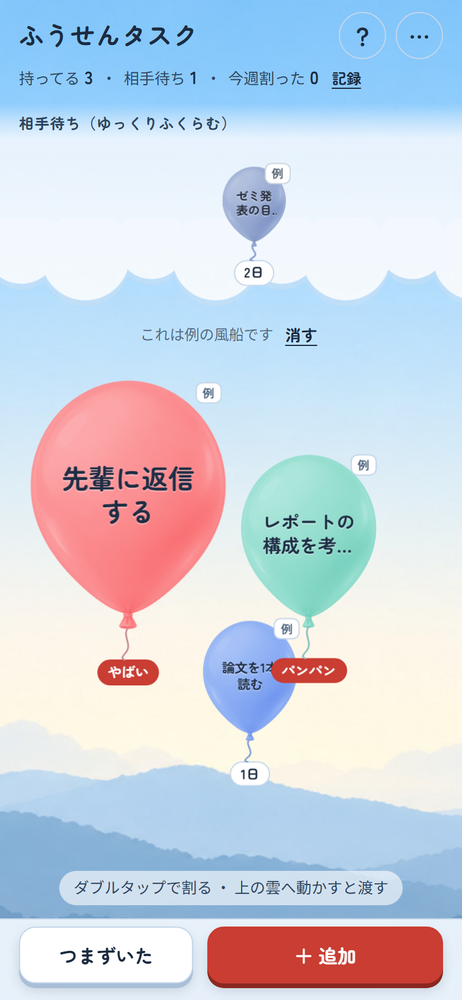

# ふうせんタスク

自分が持っているタスクを「風船」にして、持っている日数でふくらませるタスクアプリです。
「自分のボールを抱えずに、ひと手間足してすぐ返す」を、毎日の操作で体に覚えるために作りました。

## 使い方
- **開く**: https://yucca-1122.github.io/balloon-task/
  - スマホはブラウザの「ホーム画面に追加」で、アプリのように使えます。ホーム画面から開いたほうと、ブラウザで開いたほうでは、保存場所が別になります
- **追加**: ジャンルとひとことを入れて「風船にする」
- **動かす**: 風船は指で好きな場所へ動かせます。置いた場所に留まります
- **整える**: 上の「整える」を押すと、指で動かした風船が元の並びに戻ります
- **渡す**: 風船を上の雲へ動かす（途中を見せた・質問を送った・返事をした、とき）
- **割る**: 風船をダブルタップ（終わったとき）。「パン」と鳴ります（設定で消せます）
- **つまずいた**: 5つの中から近いものを選ぶと、止まっている場所と、今すぐやる一手、そのまま送れる文面の例が出ます
- **記録**: 上の数字の「記録」から。ボールを返すまでの平均日数、3日以内に返せた割合、ジャンル別の平均、割った風船の履歴が見られます
  - 履歴の行を左にスライドすると、赤い「消去」が出ます。押す（または大きくスライドする）と確認が出て、「はい」でその記録が平均からも外れます。試しに入れた風船を消したいときに

## ふくらみ方
- 自分の風船は、1日ごとに直径が2割ずつ大きくなります。3日で「パンパン」、5日で「やばい」になってふるえます
- 画面に入りきらなくなるまでふくらみ、古い風船ほど前に出ます
- 5日（やばい）を過ぎた大きい風船は、画面の真ん中に重なって出ます（古いほど手前）。どこへ動かしても、真ん中の文字の部分は画面に残ります
- それより小さい風船どうしは、重ならないように少しずつ離れます
- 相手待ちの風船は1日6%ずつゆっくりふくらみ、3日たつと「一声かける？」とゆれて光ります。「一声かけた」を押すと落ち着きます
- 放っておいても、勝手には割れません

## データの保存
- 入れたタスクは、使っている端末のブラウザの中にだけ保存されます。どこかのサーバーへ送ることはありません
- ほかの端末とは共有されません。ブラウザのデータを消すと、タスクも消えます

## ファイル
- `index.html` … 公開用のページ（`python tools/build_pages.py` で `balloon-task.html` から作ります）
- `balloon-task.html` … アプリ本体
- `assets/` … 背景（昼・夜）、風船の型、アイコン（`assets/icons/`）
- `manifest.webmanifest` … ホーム画面に追加したときの名前とアイコン
- `docs/つまずき診断の中身.md` … 「つまずいた」の答えの文面と、根拠にした研究
- `tools/` … ページを作り直す小さな道具

## 使っているもの
- 文字: [Zen Maru Gothic](https://fonts.google.com/specimen/Zen+Maru+Gothic)（Google Fonts、SIL Open Font License）
- 背景・風船・アイコンの絵: ChatGPT で生成した画像をもとに加工（アイコンは `python tools/make_icons.py <元の絵>` で大きさ違いを作ります）
- 割れる音: Web Audio でその場で合成（音のファイルは使っていません）

## 権利について
このリポジトリのコードと画像の権利は作者にあります（ライセンスは付けていません）。アプリを使うのは自由ですが、転載・改変・再配布はご遠慮ください。
